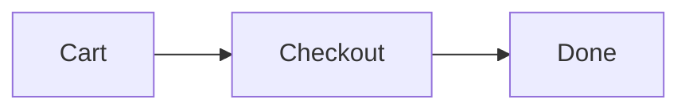

# Checkout redesign

One review with several outputs. Open it with:

```
see-plan open examples/multi/plan.md examples/multi/flow.mmd examples/multi/prototype.html examples/multi/screenshot.svg examples/multi/results.csv
```

## Steps

1. Replace the three-page checkout with a single page.
2. Remember the shipping address.
3. Show the total before the payment step.

## How the page fits together


